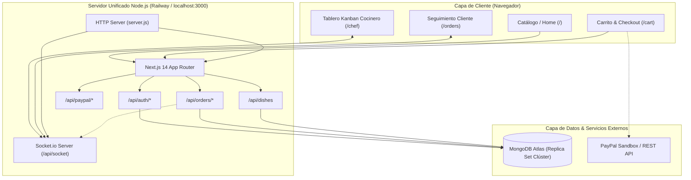
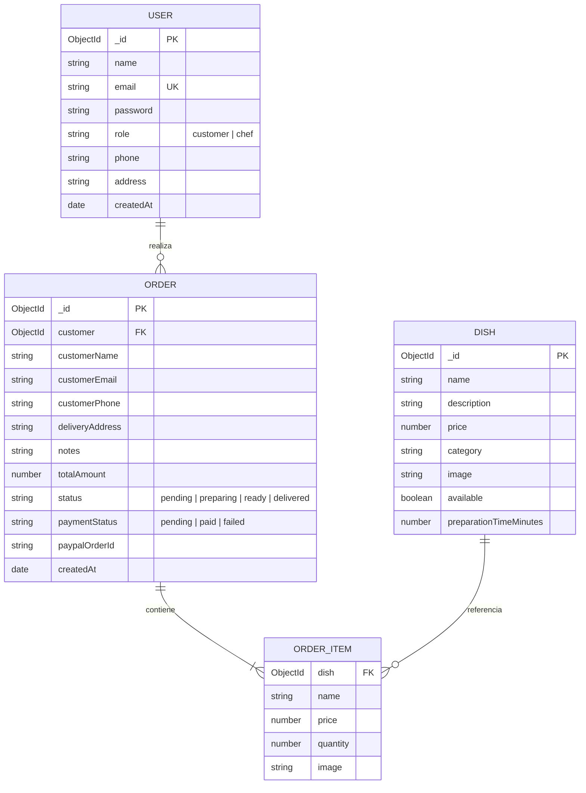

# Product Requirements Document (PRD)
## Proyecto: Fast_Food – Sistema de Pedidos y Cocina en Tiempo Real

---

## 1. Visión General del Producto

### 1.1 Declaración de la Visión
**Fast_Food** es una solución web full-stack moderna y ágil diseñada para optimizar la experiencia culinaria de pedidos en línea y la coordinación en tiempo real de cocinas comerciales. La plataforma une de forma fluida a comensales hambrientos con el personal de cocina, eliminando tiempos muertos mediante sincronización reactiva por WebSockets, pasarelas de pago seguras y tableros operativos de alto rendimiento.

### 1.2 Objetivos del Producto
- **Para los Comensales:** Proporcionar una experiencia fluida e intuitiva de navegación de menú, personalización de pedidos, pago seguro a través de PayPal y seguimiento del estado del pedido en tiempo real sin recargar la página.
- **Para el Personal de Cocina:** Centralizar la gestión operativa de pedidos mediante un tablero visual Kanban interactivo con *drag-and-drop*, reflejando de inmediato cambios de estado en toda la red de clientes y estaciones de trabajo.
- **Para el Negocio/Operador:** Automatizar la transición de pago a orden registrada en base de datos cloud (MongoDB Atlas), mitigando errores de transcripción humana y tiempos de espera.

---

## 2. Personas y Usuarios Objetivo

| Rol | Perfil | Necesidades Principales |
| :--- | :--- | :--- |
| **Cliente / Comensal** | Usuario habitual que desea ordenar comida a domicilio desde cualquier dispositivo con rapidez. | Explorar menú organizado por categorías, carrito dinámico, pago ágil con PayPal o prueba rápida, seguimiento visual de si su plato está pendiente, en preparación o listo. |
| **Cocinero / Chef** | Operario de la línea de producción culinaria que prepara los platos en el restaurante. | Visualizar órdenes entrantes al instante con detalles e instrucciones especiales, cambiar estados de manera táctil/arrastrable (*Pendiente* $\to$ *En preparación* $\to$ *Listo* $\to$ *Entregado*). |
| **Administrador del Restaurante** | Encargado del catálogo, disponibilidad y supervisión general. | Gestionar catálogo de platos, revisar pedidos globales y supervisar métricas de entrega. |

---

## 3. Requerimientos del Sistema

### 3.1 Requerimientos Funcionales (RF)

#### RF-1: Gestión de Identidad y Control de Acceso (RBAC)
- **RF-1.1:** Registro de usuarios con soporte para cualquier correo electrónico válido, nombre, contraseña (mínimo 6 caracteres con encriptación bcrypt), teléfono y dirección de entrega.
- **RF-1.2:** Asignación de roles diferenciados: `customer` (cliente) y `chef` (cocinero).
- **RF-1.3:** Autenticación mediante credenciales con emisión de JSON Web Tokens (JWT) almacenados en cookies seguras HTTP-Only.
- **RF-1.4:** Protección de rutas mediante validación de sesión: solo usuarios con rol `chef` pueden acceder a `/chef`.

#### RF-2: Catálogo de Platos y Menú Interactivo
- **RF-2.1:** Visualización en cuadrícula (*grid*) responsive de platos disponibles con imagen en alta resolución, nombre, descripción, precio en moneda local (COP) y tiempo estimado de cocción.
- **RF-2.2:** Filtro dinámico por categorías: *Hamburguesas, Pizzas, Perros Calientes, Combos, Acompañamientos, Bebidas* y vista consolidada *Todos*.
- **RF-2.3:** Estado de carga con esqueletos animados (*skeleton loaders*) para optimizar la experiencia de usuario (UX).

#### RF-3: Carrito de Compras y Resumen de Orden
- **RF-3.1:** Carrito desplegable (*drawer*) accesible globalmente sin abandonar la vista actual.
- **RF-3.2:** Incremento, decremento o remoción de ítems con recálculo automático de subtotales y total general.
- **RF-3.3:** Persistencia local del carrito (`localStorage`) para resguardar la selección ante recargas accidentales.

#### RF-4: Pasarela de Pago y Creación de Reserva/Pedido
- **RF-4.1:** Formulario de checkout con captura de dirección de entrega, teléfono de contacto y notas especiales de preparación.
- **RF-4.2:** Integración con **PayPal JavaScript SDK & Buttons** (`@paypal/react-paypal-js`) para autorización y captura en tiempo real.
- **RF-4.3:** Soporte de botón de confirmación en modo Demo/Desarrollo para verificación rápida sin barreras de pasarela externa.
- **RF-4.4:** Generación automática de la orden en la base de datos con estado inicial `pending` y asociación al usuario autenticado (o datos de contacto provistos).

#### RF-5: Tablero Kanban de Cocina en Tiempo Real
- **RF-5.1:** Interfaz de 4 columnas de progresión:
  1. 🟡 **Pendiente**
  2. 🟠 **En preparación**
  3. 🔵 **Listo**
  4. 🟢 **Entregado**
- **RF-5.2:** Interacción bidireccional mediante **Drag and Drop nativo HTML5** para mover tarjetas de pedido entre estados.
- **RF-5.3:** Botones de avance rápido en cada tarjeta (*→ Preparar*, *→ Listo*, *→ Entregar*).
- **RF-5.4:** Visualización clara de ID de pedido, hora de ingreso, lista de platos con cantidades y notas especiales del cliente.

#### RF-6: Comunicación en Tiempo Real (WebSockets)
- **RF-6.1:** Servidor Socket.io acoplado en `/api/socket`.
- **RF-6.2:** Emisión del evento `order:created`: Al confirmar un pedido, la tarjeta aparece en el Kanban del cocinero de manera instantánea y sin refrescar.
- **RF-6.3:** Emisión del evento `order:status_updated`: Al mover una tarjeta en el Kanban, el nuevo estado se propaga inmediatamente a todas las sesiones de cocina y a la vista de seguimiento del cliente (`/orders`).

---

### 3.2 Requerimientos No Funcionales (RNF)

- **RNF-1 (Rendimiento):** Tiempo de respuesta de endpoints API inferior a 250 ms en condiciones normales de red.
- **RNF-2 (Disponibilidad y Concurrencia):** Soporte de conexiones persistentes Full-Duplex vía WebSocket concurrentes sin degradación de la latencia.
- **RNF-3 (Seguridad):** 
  - Almacenamiento de contraseñas hasheadas mediante `bcryptjs` con salado de 10 rondas.
  - Secretos y cadenas de conexión aisladas en variables de entorno (`.env` / Railway Environment Variables).
  - Cookies con flags `httpOnly` y `sameSite: 'lax'`.
- **RNF-4 (Usabilidad & Responsive Design):** Interfaz adaptativa para pantallas móviles, tabletas y monitores de cocina (pantalla completa para Kanban) construida con Tailwind CSS.
- **RNF-5 (Portabilidad):** Arquitectura autocontenida ejecutable en entornos locales (Node.js) y contenedores cloud (Railway Nixpacks/Docker).

---

## 4. Arquitectura Técnica y Tecnologías

### 4.1 Stack Tecnológico
- **Frontend:** Next.js 14 (App Router), React 18, Tailwind CSS, Lucide React Icons.
- **Backend:** Node.js (HTTP Server unificado con Next.js handler), APIs REST en rutas Next.js (`/api/*`).
- **WebSockets:** Socket.io (Servidor en Node.js, cliente con `socket.io-client`).
- **Base de Datos:** MongoDB Atlas gestionado a través de Mongoose ODM con patrón singleton para conexión en caché.
- **Autenticación:** JWT (`jsonwebtoken`), `bcryptjs`, Cookies HTTP-Only.
- **Pasarela de Pago:** `@paypal/react-paypal-js`.
- **Infraestructura y Despliegue:** Railway PaaS (Despliegue unificado continuo con Nixpacks y dominio SSL automático).

---

## 5. Modelo de Datos Entidad-Relación

---

## 6. Flujos Clave de Usuario

### 6.1 Flujo del Comensal: Selección, Pago y Seguimiento en Vivo
1. El comensal ingresa a la aplicación (`/`) y explora los platos disponibles o filtra por categoría.
2. Añade productos al carrito con el botón `+ Agregar`.
3. Abre el carrito y pulsa `Proceder al Pago`.
4. En `/cart`, ingresa sus datos de entrega y selecciona el botón de **PayPal**.
5. Aprueba la transacción en la ventana modal de PayPal.
6. El backend recibe la confirmación, registra la orden en MongoDB y dispara el evento WebSocket `order:created`.
7. El cliente es redirigido a `/orders` donde observa su pedido en estado inicial `Pendiente`.

### 6.2 Flujo del Cocinero: Recepción y Despacho en Kanban
1. El cocinero inicia sesión con rol `chef` y entra automáticamente a `/chef`.
2. Al crearse una nueva orden, la tarjeta aparece en tiempo real en la columna **Pendiente**.
3. El cocinero toma el pedido y lo arrastra a la columna **En preparación** (o presiona `→ Preparar`).
4. El servidor emite `order:status_updated`. La pantalla del cliente cambia automáticamente a **En preparación**.
5. Al finalizar el plato, el cocinero lo traslada a **Listo** y posteriormente a **Entregado**.

---

## 7. Plan de Despliegue y Operaciones

| Componente | Configuración |
| :--- | :--- |
| **Repositorio / Código** | Proyecto monorepo estructurado en raíz, versionado con Git. |
| **Plataforma de Hosting** | Railway (`https://railway.com`) con despliegue de contenedor Node.js. |
| **Variables de Entorno** | `NODE_ENV`, `PORT`, `MONGODB_URI`, `JWT_SECRET`, `NEXT_PUBLIC_PAYPAL_CLIENT_ID`, `PAYPAL_CLIENT_SECRET`. |
| **Base de Datos** | Clúster Cloud en MongoDB Atlas con reglas de acceso abiertas a Railway (`0.0.0.0/0`). |
| **Dominio y Certificados** | Subdominio provisto por Railway con terminación TLS/SSL automática (`https://fastfood-production-4880a5e3.up.railway.app`). |

---

## 8. Criterios de Aceptación y Métricas de Éxito

- **Prueba de WebSockets:** Menos de 500 ms de latencia percibida entre el cambio de estado en el Kanban y la actualización en la pantalla del cliente.
- **Conectividad de Base de Datos:** Persistencia correcta de usuarios, platos y pedidos en MongoDB Atlas.
- **Control de Acceso:** Clientes sin rol `chef` no pueden ingresar a `/chef` bajo ninguna circunstancia.
- **Tasa de Éxito de Pedidos:** 100% de los pagos aprobados por PayPal generan un registro de pedido íntegro con ítems y dirección.
