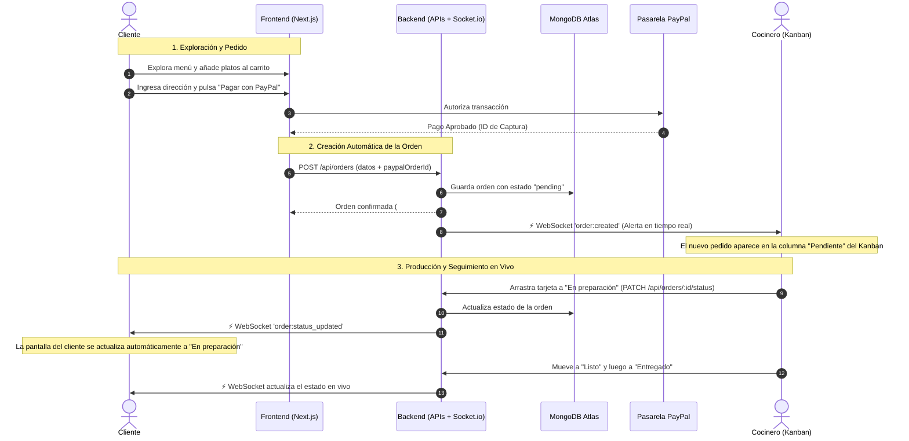

# 🍔 Fast_Food – Sistema Full-Stack de Pedidos y Cocina en Tiempo Real

> Aplicación web moderna para la reserva, pedido y seguimiento de platos de restaurante, integrando pagos con PayPal y un tablero Kanban sincronizado en tiempo real mediante WebSockets para el personal de cocina.

---

## 📌 Descripción del Proyecto

**Fast_Food** es una solución full-stack diseñada para conectar a comensales y cocinas de restaurantes de forma eficiente, ágil y transparente. La aplicación permite a los clientes explorar el menú de platos clasificados por categorías, gestionar un carrito interactivo, ingresar detalles y dirección de entrega, y efectuar el pago seguro mediante **PayPal**. Al confirmar la transacción, la orden se registra automáticamente como una reserva/pedido y se transmite instantáneamente al **Dashboard del Cocinero**, el cual cuenta con un **tablero Kanban interactivo con drag-and-drop** que sincroniza el avance del pedido (*Pendiente* $\to$ *En preparación* $\to$ *Listo* $\to$ *Entregado*) en tiempo real hacia la pantalla del cliente.

---

## 🎯 Objetivos del Sistema

1. **Optimizar la experiencia del comensal:** Facilitar la exploración de platos, simplificar el checkout con pasarela de pago digital y permitir el seguimiento en vivo del pedido sin necesidad de recargar la página.
2. **Centralizar la operativa de cocina:** Brindar a los cocineros una herramienta visual interactiva (Kanban) que elimine comandas físicas y permita arrastrar tarjetas de pedidos a medida que se preparan.
3. **Comunicación reactiva Full-Duplex:** Integrar WebSockets para que cualquier cambio de estado en la cocina se refleje al instante en los dispositivos de los comensales.
4. **Arquitectura unificada y segura:** Alojar frontend, APIs REST y servidor de WebSockets bajo un único puerto y dominio, eliminando barreras de CORS y facilitando el despliegue en la nube.

---

## 🛠️ Stack Tecnológico

| Capa | Tecnología | Descripción |
| :--- | :--- | :--- |
| **Frontend** | [Next.js 14](https://nextjs.org/) (App Router) + [React 18](https://react.dev/) | Renderizado híbrido de interfaz de usuario con arquitectura de componentes modernos. |
| **Estilos & UI** | [Tailwind CSS](https://tailwindcss.com/) + [Lucide Icons](https://lucide.dev/) | Diseño limpio, moderno, visualmente atractivo y totalmente responsive. |
| **Backend & APIs** | Node.js (Servidor HTTP nativo) + Next.js Route Handlers | APIs REST unificadas para usuarios, platos, pedidos y pagos bajo `/api/*`. |
| **Tiempo Real** | [Socket.io](https://socket.io/) (Server & Client) | Conexiones persistentes y bidireccionales (`order:created`, `order:status_updated`). |
| **Base de Datos** | [MongoDB Atlas](https://www.mongodb.com/atlas) + [Mongoose](https://mongoosejs.com/) | Base de datos NoSQL documental en la nube con esquemas tipados y caché singleton. |
| **Autenticación** | JWT (`jsonwebtoken`) + [bcryptjs](https://github.com/dcodeIO/bcrypt.js) | Encriptación de claves, sesiones seguras con cookies HTTP-Only y control por roles (`customer` y `chef`). |
| **Pasarela de Pago** | [@paypal/react-paypal-js](https://github.com/paypal/react-paypal-js) | Integración con PayPal SDK Buttons (Sandbox y Live). |
| **Despliegue Cloud** | [Railway](https://railway.com/) | Hosting continuo en la nube para el servidor Node.js + WebSockets con SSL automático. |

---

## 🔄 Flujo de Ejecución y Operación



---

## 👥 Roles de Usuario y Accesos

- **Cliente (`customer`):**
  - Acceso libre a la exploración del menú (`/`).
  - Uso del carrito de compras desplegable.
  - Formulario de entrega y pasarela de pago PayPal (`/cart`).
  - Pantalla de seguimiento de sus pedidos en tiempo real (`/orders`).
- **Cocinero (`chef`):**
  - Acceso restringido al Dashboard de Cocina (`/chef`).
  - **Tablero Kanban con 4 columnas:** *Pendiente*, *En preparación*, *Listo* y *Entregado*.
  - Arrastre interactivo de pedidos (*Drag and Drop* nativo) y botones de avance rápido.
  - Notificaciones en tiempo real al ingresar nuevos pedidos.

---

## 🚀 Instalación y Puesta en Marcha Local

### 1. Clonar el repositorio y acceder a la carpeta
```bash
git clone <url-del-repositorio>
cd FastFood
```

### 2. Instalar dependencias
```bash
npm install
```

### 3. Configurar variables de entorno
Crea un archivo `.env` o `.env.local` en la raíz del proyecto (puedes guiarte de `.env.example`):
```env
# MongoDB Atlas o Local
MONGODB_URI=mongodb+srv://<usuario>:<password>@cluster.mongodb.net/fast_food?retryWrites=true&w=majority

# Clave secreta para JWT
JWT_SECRET=tu_clave_secreta_jwt_muy_segura

# Credenciales de PayPal Developer (Sandbox)
NEXT_PUBLIC_PAYPAL_CLIENT_ID=tu_paypal_client_id
PAYPAL_CLIENT_SECRET=tu_paypal_client_secret

# Puerto y URL base
PORT=3000
NEXT_PUBLIC_BASE_URL=http://localhost:3000
```

### 4. Poblar la base de datos con platos y usuarios demo
```bash
npm run seed
```
> Esto creará 8 platos gourmet/comida rápida y 2 usuarios de prueba:
> - 👨‍🍳 **Cocinero:** `cocinero@fastfood.com` | Contraseña: `123456`
> - 👤 **Cliente:** `cliente@fastfood.com` | Contraseña: `123456`

### 5. Iniciar la aplicación
```bash
npm run dev
```
Abre tu navegador en:
👉 **`http://localhost:3000`**

---

## ☁️ Despliegue en la Nube (Railway)

El proyecto está preparado para ejecutarse como un servicio continuo de Node.js en **Railway**:
- **URL pública desplegada:** `https://fastfood-production-4880a5e3.up.railway.app`
- **Comando de inicio en producción:** `npm start` (ejecuta `node server.js` acoplando Next.js y WebSockets en un solo proceso).
- **Importante para MongoDB Atlas:** Asegúrate de agregar la regla `0.0.0.0/0` en *Network Access* de MongoDB Atlas para permitir la conexión desde las IPs de la nube.

---

## 📄 Documentación Adicional

- 📋 [PRD.md](PRD.md): Documento de Requisitos de Producto exhaustivo.
- 📐 [planning.md](planning.md): Plan de arquitectura e ingeniería del sistema.
