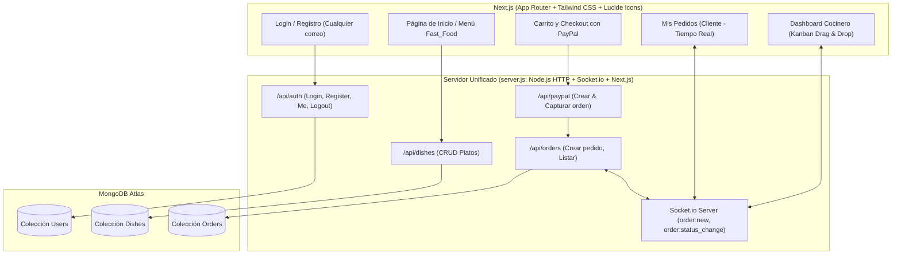

# Plan de Implementación: Fast_Food Full-Stack Web App

Sistema completo de reserva y pedido de platos de restaurante para **Fast_Food**, desarrollado con arquitectura full-stack moderna (Next.js App Router + Servidor Node.js HTTP con Socket.io integrado para backend unificado, MongoDB Atlas con Mongoose, autenticación con JWT y correos estándar, pasarela PayPal y tablero Kanban en tiempo real con drag-and-drop).

---

## 1. Goal Description

El objetivo es crear una solución web completa, limpia, moderna y responsive para **Fast_Food**:
1. **Clientes**: Explorar menú categorizado de platos, agregar items al carrito con cantidades, ingresar detalles y dirección de entrega, efectuar el pago mediante PayPal (SDK / Buttons) y generar automáticamente el pedido/reserva. Cuentas con cualquier correo electrónico válido.
2. **Cocineros / Admin**: Acceder a un Dashboard exclusivo con tablero Kanban interactivo con soporte drag-and-drop y sincronización en tiempo real vía WebSockets (Socket.io) para cambiar pedidos entre:
   - `Pendiente`
   - `En preparación`
   - `Listo`
   - `Entregado`
3. **Backend & WebSockets (Decisión más sencilla y segura)**:
   Un único servidor Node.js (`server.js`) que envuelve la app de Next.js mediante el servidor HTTP nativo de Node y acopla Socket.io en el mismo puerto (ej. `3000`). Todas las rutas API (`/api/*`) residen en Next.js App Router y los eventos WebSocket corren directamente en la misma instancia compartida, eliminando problemas de CORS, doble puerto o microservicios innecesarios.



---

## 2. Decisiones Arquitectónicas (Sencilla y Segura)

1. **Nombre de la App**: `Fast_Food`. Marca neutral y moderna.
2. **Autenticación sin restricción de dominio**: Cualquier correo electrónico válido (ej. `gmail.com`, `outlook.com`, corporativos o personalizados). Validación con Regex estándar.
3. **Servidor Unificado**:
   - `server.js` inicializa `createServer` de Node.js con Next.js preparado (`app.prepare()`).
   - Se vincula `new Server(httpServer, { path: "/api/socket" })`.
   - Se inyecta la instancia de `io` globalmente (`global.io = io`) para que las Server Actions o API Routes (`/api/orders`) puedan emitir eventos a los sockets conectados de manera inmediata y segura.
   - Tanto el frontend, las APIs REST como los WebSockets operan en un solo puerto (por defecto `http://localhost:3000`), sin complicaciones de puertos cruzados ni configuraciones complejas de proxy.

---

## 3. Estructura del Proyecto

```text
FastFood/
├── planning.md                   # Copia de este documento en el workspace
├── .env.local                    # Configuración de entorno
├── package.json                  # Dependencias y scripts
├── server.js                     # Servidor Node.js HTTP + Socket.io + Next.js
├── tailwind.config.js
├── tsconfig.json
├── src/
│   ├── app/
│   │   ├── layout.tsx            # RootLayout con Providers (Auth, Socket, Cart)
│   │   ├── page.tsx              # Landing / Menú público de Fast_Food
│   │   ├── login/page.tsx        # Login diferenciado (Cliente / Cocinero)
│   │   ├── register/page.tsx     # Registro de usuarios
│   │   ├── cart/page.tsx         # Resumen de pedido & Checkout con PayPal
│   │   ├── orders/page.tsx       # Seguimiento de pedidos del cliente en tiempo real
│   │   └── chef/
│   │       └── page.tsx          # Tablero Kanban para Cocineros con drag-and-drop
│   │   └── api/
│   │       ├── auth/
│   │       │   ├── login/route.ts
│   │       │   ├── register/route.ts
│   │       │   └── me/route.ts
│   │       ├── dishes/route.ts
│   │       ├── orders/
│   │       │   ├── route.ts
│   │       │   └── [id]/status/route.ts
│   │       └── paypal/
│   │           ├── create-order/route.ts
│   │           └── capture-order/route.ts
│   ├── components/
│   │   ├── Navbar.tsx
│   │   ├── DishCard.tsx
│   │   ├── CartDrawer.tsx
│   │   ├── PaypalButtonWrapper.tsx
│   │   └── kanban/
│   │       ├── KanbanBoard.tsx
│   │       ├── KanbanColumn.tsx
│   │       └── KanbanCard.tsx
│   ├── context/
│   │   ├── AuthContext.tsx       # Estado de sesión y roles
│   │   ├── CartContext.tsx       # Carrito persistente
│   │   └── SocketContext.tsx     # Conexión Socket.io cliente
│   ├── lib/
│   │   ├── db.ts                 # Conexión a MongoDB con Mongoose (singleton con caché)
│   │   ├── auth.ts               # Utilidades JWT, hashing bcrypt y middleware RBAC
│   │   └── socket.ts             # Emisor de eventos Socket para las API Routes
│   ├── models/
│   │   ├── User.ts               # Esquema de Usuario (roles: 'customer' | 'chef')
│   │   ├── Dish.ts               # Esquema de Plato (nombre, precio, img, categoría, etc.)
│   │   └── Order.ts              # Esquema de Pedido (platos, total, dirección, estado, paypalId)
│   └── scripts/
│       └── seed.js               # Semilla con platos gourmet/fast food y usuarios de prueba
```

---

## 4. Modelos de Base de Datos (Mongoose)

- **`User`**:
  - `name`: String
  - `email`: String (único, validación estándar de email)
  - `password`: String (hasheada con bcryptjs)
  - `role`: `'customer' | 'chef'`
  - `phone`: String
  - `address`: String

- **`Dish`**:
  - `name`: String
  - `description`: String
  - `price`: Number
  - `category`: String (`Hamburguesas`, `Pizzas`, `Perros calientes`, `Bebidas`, `Acompañamientos`)
  - `image`: String (URL de alta resolución de Unsplash)
  - `available`: Boolean

- **`Order`**:
  - `customer`: Ref `User`
  - `customerName`: String
  - `customerPhone`: String
  - `deliveryAddress`: String
  - `items`: `[{ dish: Ref Dish, name: String, price: Number, quantity: Number }]`
  - `totalAmount`: Number
  - `status`: `'pending' | 'preparing' | 'ready' | 'delivered'`
  - `paymentStatus`: `'paid' | 'pending'`
  - `paypalOrderId`: String
  - `createdAt`, `updatedAt`: Timestamps

---

## 5. Plan de Ejecución Paso a Paso

1. **Guardar el archivo de planning** en el directorio del proyecto (`planning.md`).
2. **Inicializar el proyecto**:
   - Crear `package.json` con dependencias: `next`, `react`, `react-dom`, `mongoose`, `socket.io`, `socket.io-client`, `bcryptjs`, `jsonwebtoken`, `@paypal/react-paypal-js`, `lucide-react`, `tailwindcss`, `@hello-pangea/dnd` (o drag-and-drop reactivo nativo), etc.
   - Configurar `tsconfig.json`, `tailwind.config.js`, `postcss.config.js`.
3. **Base de Datos y Modelos**:
   - `src/lib/db.ts` con manejo de conexión Mongoose reutilizable.
   - `User.ts`, `Dish.ts`, `Order.ts`.
4. **Backend Unificado & WebSockets**:
   - `server.js` configurado para escuchar eventos de Socket.io y servir Next.js en el mismo puerto.
   - `src/lib/socket.ts` para permitir que las API routes emitan eventos a los clientes conectados.
5. **Autenticación & API Routes**:
   - Registro / Login con JWT y cookies HTTP-only.
   - Endpoint de verificación de sesión `/api/auth/me`.
   - Endpoints CRUD de platos y pedidos.
   - Endpoints de integración con PayPal.
6. **Frontend & UI**:
   - Interfaz moderna, limpia y responsive para `Fast_Food`.
   - Navegación con detección de rol (`cliente` / `cocinero`).
   - Catálogo interactivo con carrito de compras y checkout con PayPal.
   - Seguimiento en vivo de pedidos para el cliente (`/orders`).
   - Tablero Kanban interactivo con 4 columnas y drag & drop para el cocinero (`/chef`).
7. **Seed & Pruebas**:
   - Script de seed con usuarios demo (`cliente@fastfood.com`, `cocinero@fastfood.com`) y menú de platos variado.
   - Verificación de compilación y pruebas de flujos.
